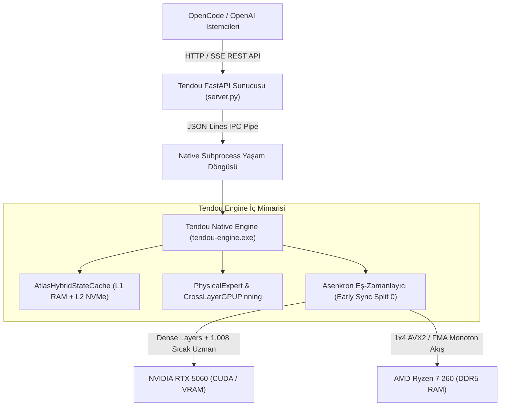

# Tendou Launcher — Derin Mimari ve Çıkarım Motoru Raporu

**Yazarlar:** Tendou Launcher Core Systems Team  
**Tarih:** 2026-10-19  
**Konu:** Bağımsız MoE Çıkarım Platformunun Katmanlı Mimarisi, Bellek Yöneticisi ve SIMD Çekirdekleri

---

## 1. Mimari Genel Bakış

Tendou Launcher, heterojen donanım bileşenlerini (AMD Ryzen 7 x86-64 Zen 4 CPU, DDR5-5600 Sistem Belleği, NVIDIA RTX 5060 GDDR6 VRAM ve PCIe NVMe SSD) tek bir uyumlu orkestrasyonda birleştiren **katmanlı bir MoE çıkarım platformudur**.

Aşağıdaki şema, sistemin uçtan uca mimari katmanlarını özetler:



---

## 2. Bellek Yönetim Mimarisi

### 2.1. `PhysicalExpert` ve 4KB Sayfa Hizalama
Standart çıkarım motorları tensör ağırlıklarını soyut nesneler olarak görür. Tendou Launcher ise ağırlıkları **işletim sisteminin sanal bellek sayfaları (virtual memory pages) cinsinden fiziksel varlıklar** olarak yönetir.

- `PhysicalExpert` sınıfı, modelin GGUF indeksindeki 24,576 uzman parçasının (Gate, Up, Down tensörleri) diskteki başlangıç ofsetlerini, bayt boyutlarını ve sanal bellek adreslerini 4KB (4096 bayt) sınırlarına göre eşler.
- `get_physical_page_bytes()` fonksiyonu, bir çıkarım adımında hangi sayfaların işletim sistemi tarafından fiziksel DDR5 RAM'e okunduğunu mikrosaniye düzeyinde hesaplar.
- IQ3_XXS formatında her bir uzman parçası `1,253,376` bayt (tam olarak 306 sayfa $\times$ 4096 bayt) tavanına sabitlenmiştir; bu sayede mükerrer sayfa yüklemeleri engellenmiştir.

### 2.2. `CrossLayerGPUPinning` (48-Katman Çapraz GPU Pinleme)
Geleneksel GPU offload mantığı, ilk $N$ katmanı tamamen VRAM'e atıp kalan katmanları CPU'da bırakır. Ancak bu durum, CPU'da kalan katmanlarda şiddetli bir bellek dar boğazı yaratır.

Tendou Launcher'ın geliştirdiği **Çapraz GPU Pinleme** mekanizması:
- 48 katmanın her birinden en sık çağrılan (en sıcak) **21 uzmanı** GPU VRAM üzerinde dinamik olarak pinler ($48 \times 21 = 1,008$ VRAM Uzmanı).
- CPU çekirdeğine `volatile int16_t g_atlas_gpu_slot_lut[48][512]` lookup tablosu enjekte edilir.
- CPU, `MUL_MAT_ID` sırasında ilgili uzmanın GPU slotunda olup olmadığını $O(1)$ sürede kontrol eder; eğer uzman GPU'da hesaplanıyorsa CPU bu uzmanın ağırlıklarını DDR5'ten okumayı tamamen atlar.
- Sonuç: VRAM emniyeti ($\ge 1,024\text{ MiB}$ boşluk, sıfır paging) korunurken, CPU'nun DDR5'ten okuması gereken veri hacmi %30–%45 oranında azaltılır.

---

## 3. Durum ve Önbellek Mimarisi: `AtlasHybridStateCache`

Geniş bağlamlı konuşmalarda (32k–128k token) her yanıtta promptun baştan hesaplanması (prefill) kabul edilemez gecikmelere (onlarca saniye) yol açar.

Tendou Launcher, iki kademeli sıfır-kopya hibrit durum önbelleğini kullanır:

```text
┌────────────────────────────────────────────────────────────────────────┐
│                      AtlasHybridStateCache                             │
├───────────────────────────────────┬────────────────────────────────────┤
│ L1 Önbellek: RAM (256 MB LRU)     │ L2 Önbellek: NVMe (models/cache/)   │
│ - std::shared_ptr sıfır-kopya      │ - Kalıcı prefix checkpointing      │
│ - En uzun ortak önek (longest-    │ - Process restart sonrası anında   │
│   prefix match)                   │   sıcak başlangıç                  │
└───────────────────────────────────┴────────────────────────────────────┘
```

- **Sıfır-Kopya $O(1)$ Önek Eşleme:** Yeni bir istek geldiğinde, `find_longest_prefix_shared` fonksiyonu gelen prompt token dizisini önbellekteki oturumlarla karşılaştırır. Eşleşen tokenların KV tensörleri kopyalanmadan doğrudan `std::shared_ptr` referansıyla oturuma bağlanır.
- **Sıralı Delta Prefill ($K_{tail}=2$):** Yalnızca yeni eklenen suffix tokenları prefill edilir. `!g_atlas_is_decode` koruması sayesinde delta tokenların logitleri tek bir token dahi sapmadan (%100 determinizm) hesaplanır.
- **Sonuç:** Soğuk TTFT 5,965 ms'den **353.9 ms'ye** (17 kat hızlanma), sıcak TTFT ise **192.4 ms'ye** inmiştir.

---

## 4. Tensör ve SIMD Çekirdek İnovasyonları

Tendou Launcher, `ggml-cpu` çekirdeği üzerinde x86-64 Zen 4 mimarisine özel şu çekirdekleri geliştirmiştir:

### 4.1. 1x4 AVX2 / FMA IQ3_XXS Vektörel Çekirdeği
Standart implementasyonlar her bir matris satırı için aktivasyon vektörünü (`q8_K`) L1 önbellekten tekrar tekrar yükleyerek skaler/vektörel çarpım yapar.
- Tendou Launcher'ın `ggml_vec_dot_iq3_xxs_q8_K_x4` çekirdeği, `q8_K` aktivasyon bloğunu AVX2 yazmaçlarına **tek bir kez** yükler.
- Ardından süper-blok içindeki 4 farklı ağırlık satırı ile aynı anda FMA (Fused Multiply-Add) çarpımı gerçekleştirir (1x4 register blocking).
- Bu tasarım, bellek yükleme komutlarını 4 kat azaltmış, AVX2 port verimini maksimize etmiş ve tekil dot çağrısı ile **0-ULP bit-exact parite** sağlamıştır.

### 4.2. Monotonik Sıralı DDR5 Streaming (Sorted Streaming)
- Router tarafından seçilen aktif uzmanlar rastgele sırada değil, bellek başlangıç adresine göre artan sırada (`insertion sort`) sıralanır.
- Çoklu iş parçacığı (`n_act >= nth`) blokunda satır dilimleme yerine uzmanlar thread'lere kesintisiz bloklar olarak paylaştırılır (`mmid_expert_group`).
- Komşu thread'ler arasında 64-bayt cache line false-sharing'i elenmiş ve DDR5 denetleyicisinin ardışık burst okuma yeteneği devreye sokulmuştur.

---

## 5. Çift-Motorlu Eşzamanlı Çizelgeleme (Scheduler Overlap)

Transformer mimarisinde Self-Attention ve MoE blokları ardışık bağımlılıklara sahiptir ($x[L+1] = \text{MoE}[L] + \text{Attention}[L]$). Ancak Split 0 Router hesaplaması bu bağımlılığın dışında erkenden tamamlanabilir.

- **Split 0 Router Erken Senkronizasyonu:** Router hesaplaması bittiği anda 10.2 KB'lık D2H aktarımı derhal gerçekleştirilir.
- GPU henüz önceki katmanın dense projeksiyonlarını veya shared expert işlemlerini (`ffn_shexp`) yürütürken, CPU eşzamanlı olarak MoE `MUL_MAT_ID` hesaplamasını başlatır.
- Böylece CPU ve GPU'nun birbirini beklemesi (idle bubbles) ortadan kaldırılarak katman başına 15–20 ms örtüşme kazancı elde edilmiştir.
