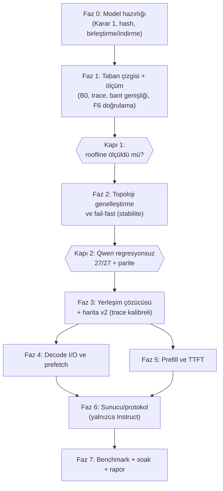

# Llama-4 Scout mimari desteği — optimizasyon, stabilite ve benchmark planı

## Hedef

`llama4` (Llama-4-Scout-17B-16E, Q6_K, 48 katman × 16 uzman, **Top-1 + paylaşımlı uzman**) mimarisini tendou launcher'a eklemek. İlk Qwen-dışı mimari olduğu için amaç iki yönlüdür:

1. Motoru modelden bağımsız hale getirmek (sabit `48×512` varsayımlarını kaldırmak).
2. Bu donanımda (16 GB RAM, RTX 5060 8 GB, WD SN5000S NVMe) Scout'u **kararlı** ve **ölçülmüş** biçimde çalıştırmak.

Bu belge gelecekte `llama4` veya benzeri Top-1 / Shared Expert mimarileri projeye dahil edileceği zaman uygulanmak üzere hazırlanmış referans spesifikasyon ve uygulama planıdır.

---

## Kod okumasından çıkan bulgular

Aşağıdakiler planı belirleyen bulgulardır. Her biri kaynaktan doğrulandı; "tahmin" etiketli olanlar Faz 1'de ölçülecek.

| # | Bulgu | Kanıt | Sonuç |
|---|---|---|---|
| F1 | İndirilen dosya **base** model, Instruct değil. | GGUF `general.source.url = meta-llama/Llama-4-Scout-17B-16E` | Chat ve tool-calling testleri base üzerinde anlamsız. Performans/stabilite testleri geçerli. |
| F2 | `.gguf.part1of2/2of2` **ham bayt bölümü**, GGUF shard değil. Part 2 GGUF başlığı taşımıyor (magic `59 07 08 80`). | Part 2'nin ilk baytları okundu | llama.cpp yükleyemez. Birleştirmek gerekir. Diskte 17.9 GB boş, birleştirme normalde +88 GB ister. |
| F3 | Part'lar hash ile doğrulanmadı, yalnızca boyut eşleşti. | HF `X-Linked-ETag` (SHA-256) mevcut | Birleştirmeden önce hash doğrulaması yapılmalı. |
| F4 | Motor `48×512` sabitli: `ExpertIDMapper::NUM_EXPERTS=512`, `TOTAL_EXPERTS=48*512`, `g_atlas_gpu_slot_lut[48][512]`, `layer*512+expert`. | `atlas-engine.h:441`, `atlas-engine.cpp` (60+ yer), `ggml-cpu.c:1953` | Scout (16E) stride-512 ile *çalışabilir* ama bellek/tarama israfı var ve sessiz hata riski taşır. |
| F5 | Qwen'e kalibre katman sabitleri: `layer 15–30`, `≥44`, `37–40`, `layer>=2` budama. | `ggml-cpu.c:2005–2057`, `2070` | `n_used=1` iken zararsız, ama modele özgü olduğu için bir politika tablosuna taşınmalı. |
| F6 | **`id == 0 → her zaman CPU yolu`** kuralı. Top-1'de tek uzman `id==0` olduğundan GPU-slot (Tier-0 VRAM) yolu **hiç tetiklenmiyor**. | `ggml-cpu.c:2270` | Mevcut haliyle Tier-0 VRAM uzman önbelleği Scout'ta etkisiz. Faz 1'de doğrulanacak. |
| F7 | `expected_top_k=10`, `max_candidates_per_layer=10` varsayılanları. | `atlas-engine.cpp:2517`, `atlas-engine.h:196` | Scout'ta 10/16 uzmanı (≈984 MiB/katman) spekülatif okumaya çalışır. **Bant genişliği felaketi.** Üst sınır ≤2 olmalı. |
| F8 | `gpu_first` modu `n_ubatch ≤ 64` zorluyor. | `atlas-engine.cpp:3572` | Scout'ta prefill için yıkıcı (aşağıdaki roofline). |
| F9 | Bilinmeyen modelde sessizce Qwen3.8 topolojisine düşüyor (`"Built-in topology: 48 layers x 512 experts"`). | `atlas-engine.cpp:574` | Fail-fast olmalı. |
| F10 | `autotune.py` model adı sezgisiyle çalışıyor, `dense_vram_mb = 2560` sabit. Scout'ta dense ağırlık **8.52 GiB**. | `autotune.py:200–219`, `:339` | VRAM yerleşim çözücüsü yeniden yazılmalı. |
| F11 | `server.py` Qwen ChatML (`<\|im_start\|>`) ve `<tool_call>` varsayıyor. Scout `<\|header_start\|>…<\|eot\|>` kullanır. | `server.py:1163–1261` | Şablon adaptörü gerekli (yalnızca Instruct için). |
| F12 | Bağlam kaydırma (`seq_rm`+`seq_add`) chunked-attention (8192) ile pozisyonları kaydırır. | `atlas-engine.cpp:4395–4412`, `llama4.cpp` `LLAMA_SWA_TYPE_CHUNKED` | Chunk sınırları kayar, dikkat yanlış olur. Llama4'te kapatılmalı. |
| F13 | Upstream `llama4` grafiği zaten var (sigmoid kapılama, shared expert, iSWA, NoPE). | `llama.cpp/src/models/llama4.cpp` | Grafik tarafında yeni kod gerekmiyor. İş motor politikası, yerleşim ve I/O'da. |
| F14 | Önceki turda üretilen `atlas_physical_map_llama4_scout_q6k.json`: tier ataması **indeks sırasına göre yer tutucu** (trace yok), ofsetler ham `.partNofM` düzenine göre. | `generate_llama4_scout_physical_map.py` | Topolojik olarak doğru, hotness olarak **kalibre değil**. Yeniden üretilecek. |

---

## Roofline: bu donanımda ne beklemeli

**Token başına dokunulan veri (Top-1, Q6_K, GGUF indeksinden hesaplandı):**

| Bileşen | Boyut |
|---|---|
| Dikkat (48 katman) | 2.307 GiB |
| Paylaşımlı uzman (48 katman) | 4.614 GiB |
| Çıkış (lm_head) | 0.790 GiB |
| Yönlendirilen uzman (48 × 98.44 MiB) | 4.614 GiB |
| **Toplam / token** | **12.33 GiB** |
| Not: dense toplam 8.52 GiB (token_embd satır araması, ağırlık akışı değil) | |

**VRAM:** 8151 MiB toplam, masaüstü 1203 MiB kullanıyor → ≈6.78 GiB boş. Rezerv 0.5 + KV ≈0.4 (4k bağlam) + hesap tamponu ≈0.6 (tahmin) çıkınca ağırlığa **≈5.3 GiB** kalır:
dikkat (2.31) + lm_head (0.79) + paylaşımlı uzmanın ≈22/48 katmanı (2.2 GiB). Kalan 26 katmanın shexp'i CPU/RAM'de.

**Decode tavanı** (CPU akış 35 GB/s, NVMe ≈4.8 GB/s [Faz 1'de ölçülecek], I/O ile hesap tam örtüşür varsayımı):

| RAM'den karşılanan uzman oranı `h` | NVMe süresi/token | Tavan tok/s |
|---|---|---|
| 0.11 (üniform; 8 GiB önbellek / 73.8 GiB) | 0.92 s | ≈1.1 |
| 0.30 | 0.72 s | ≈1.4 |
| 0.50 | 0.52 s | ≈1.9 |
| 0.80 | 0.21 s | ≈4.7 |
| 0.95 | 0.05 s | ≈4.4 (CPU sınırlı) |

Örtüşme yoksa değerler %15–30 düşer. Scout'ta etkin hız **`h`'ye bağlı**; Qwen'deki 25–60 tok/s ile karşılaştırılamaz.

**Prefill:** ≥ ~10 yeni token bile bir katmanın uzmanlarının çoğuna dokunur. `16·(1−(15/16)^N)` → N=20'de 11.6/16, N=64'te 15.8/16. Yani **her ubatch geçişi neredeyse tüm 73.8 GiB'ı okur** (≈16 s @ 4.47 GiB/s).

| `n_ubatch` | Tavan prefill tok/s | 4k prompt soğuk |
|---|---|---|
| 64 (mevcut `gpu_first` kısıtı) | ≈4 | ≈16 dk |
| 512 | ≈31 | ≈2 dk |
| 2048 | ≈124 | ≈33 s |

> [!WARNING]
> Önbelleğe alınmış prefix olsa bile, her turda eklenen >10 token en az bir tam-model geçişi (≈12–16 s) demektir. Agentic kullanımda **TTFT tabanı ≈10–15 s/tur**. Bu mimari özelliği; Top-K budaması Top-1'de uygulanamaz ve kayıpsız yolda kaçış yoktur.

---

## User Review Required

> [!IMPORTANT]
> **Karar 1 — Model (F1+F2).** Base model ile agentic/chat benchmark yapılamaz. İki yol:
> - **A (önerilen):** Base parçalarını sil (88 GB), `unsloth/Llama-4-Scout-17B-16E-Instruct-GGUF` Q6_K'yı indir (`Q6_K/…-00001-of-00002.gguf`, 49.9 + 38.5 GB). Bunlar **gerçek GGUF shard**, birleştirme gerekmez. Sonrasında diskte ≈17 GB boş kalır.
> - **B:** Base'i bring-up için tut. Yerinde birleştirme: part2'yi sparse işaretle, 1 GiB'lık parçaları part1'in sonuna kopyala, kopyalanan aralığı `fsutil sparse setzerodata` ile serbest bırak. Ek disk gereksinimi ≈1–2 GiB. Önce SHA-256 doğrulanır. Instruct için sonradan başka bir 88 GB boşaltmak gerekir.
>
> Motor desteği ve performans çalışması her iki yolda aynıdır (tensör düzeni aynı). Yalnızca kalite/protokol benchmark'ı Instruct ister.

> [!IMPORTANT]
> **Karar 2 — Başarı tanımı.** Decode'un 1–2 tok/s, TTFT'nin 10–15 s/tur mertebesinde olması beklenir (roofline). Kabul kriterlerini mutlak değil, **B0 (stock llama.cpp) taban çizgisine göre** koymayı öneriyorum. Onay verirseniz mutlak hedefler Faz 1 ölçümlerinden sonra yazılır.

> [!WARNING]
> **Varsayılan kapsam dışı:** "Önbellekteki uzmanlara yanlı yönlendirme" gibi sonucu değiştiren yaklaşık modlar. Projenin "doğru sonuç" önceliğiyle çelişir. İsterseniz kalite kapısı (KL/PPL) arkasında deneysel seçenek olarak eklenir.

## Open Questions

1. Karar 1: A mı B mi? (A silme içerir; geri alınamaz.)
2. Qwen3.8 (70 GB) ve Qwen3.6 (17.7 GB) modelleri disk için boşaltılabilir mi? Yalnızca B yolunda veya ikinci kuant denenecekse gerekli.
3. Soğuk-başlangıç ölçümü için sayfa önbelleğini boşaltma yöntemi: (a) Sysinternals `RAMMap -Et` (yönetici), (b) `models/qwen3.8…00002.gguf` (26.8 GB) dosyasını okuyarak çıkarma. (b) varsayılan olarak seçilir; itirazınız var mı?

---

## Genel akış



---

## Proposed Changes

### Faz 0 — Model hazırlığı `[ölçüm/dosya işi, kod yok]`

- Part hash doğrulaması: part1 `b444650b…974325`, part2 `26f0078b…bf0733` (HF ETag).
- Karar 1'e göre: A (sil + indir + shard hash) veya B (yerinde birleştirme + birleşik dosya için parça-aralığı hash'i).
- İndirme betiğine SHA-256 doğrulaması eklenir.

#### [MODIFY] `download_llama4_scout.py`
SHA-256 doğrulama, Instruct shard URL'leri, `--verify-only`.

---

### Faz 1 — Taban çizgisi ve ölçüm altyapısı `[davranış değişmez]`

Amaç: roofline varsayımlarını gerçeğe çevirmek ve F6'yı doğrulamak.

1. **B0**: stock `llama-bench.exe` / `llama-cli.exe` ile `-ngl 99 -ot "blk\..*\.ffn_(up|down|gate)_exps=CPU"`, mmap, `n_ubatch ∈ {64, 512, 2048}`, `op_offload` açık/kapalı. (Binary'ler mevcut.)
2. **Donanım mikro-benchmark'ı**: NVMe ardışık okuma (32 MiB blok, QD 1/4/8, buffered vs `FILE_FLAG_NO_BUFFERING`), DDR5 akış hızı, PCIe H2D (pageable/pinned).
3. **Yönlendirme trace'i**: motorun mevcut `--atlas-trace` yolu ile farklı alanlarda (nesir, kod, çok dilli, uzun bağlam) `(katman, uzman)` kayıtları. Çıktı: katman başına uzman frekans dağılımı, çarpıklık (skew), ardışık-token uzman tekrar oranı, katmanlar-arası ilişki matrisi.
4. **F6 doğrulaması**: `n_used=1` ile `slot_lut` yolunun gerçekten hiç tetiklenmediğini sayaçla göster.
5. `llama-fit-params.exe` ile gerçek VRAM tamponu ve KV boyutu.

#### [NEW] `scripts/bench_storage_roofline.py`
NVMe/RAM/PCIe mikro-benchmark, JSON çıktısı.

#### [NEW] `scripts/analyze_moe_trace.py`
Trace'ten skew, hit-rate-vs-cache-size eğrisi (LRU/LFU/oracle), katmanlar-arası tahmin doğruluğu.

**Kapı 1:** Ölçülen NVMe hızı, `h(önbellek boyutu)` eğrisi ve B0 sayıları roofline'dan ≤%25 sapıyorsa devam. Aksi halde plan bu sayılarla yeniden yazılır.

---

### Faz 2 — Topoloji genelleştirme ve fail-fast `[stabilite çekirdeği]`

Sabit `48/512` yerine GGUF'tan okunan çalışma zamanı topolojisi ve model-politika tablosu.

#### [MODIFY] `src/atlas/atlas-engine.h` ve `src/atlas/atlas-engine.cpp`

```cpp
struct ModelTopology {            // GGUF'tan doldurulur, bilinmeyen arch → hata
    std::string arch;             // "llama4" | "qwen35moe" | "qwen4exp"
    int  n_layers, n_experts, n_used;
    int  stride;                  // flat indeks adımı = next_pow2(n_experts)
    bool has_shared_expert;
    bool pure_attention;          // llama4: true → recurrent state yok
    bool ctx_shift_safe;          // llama4 (chunked attn): false
    size_t expert_bytes_max;
};

struct MoePolicy {                // ggml-cpu.c / engine'deki literal'lerin yerine
    int prefill_topk_cap;         // qwen: 4, llama4: 0 (n_used=1)
    int max_prefetch_candidates;  // qwen: 10, llama4: 2   (F7)
    int cpu_tail_layers;          // qwen: >=44 kuralı, llama4: 0
    int n_ubatch_min;             // llama4: 512            (F8)
    bool gpu_slot_primary_ok;     // llama4: true           (F6)
};
```

Değişiklikler:
- `TOTAL_EXPERTS`, `NUM_EXPERTS`, `layer*512`, `[48][512]` → `topo.stride` ve derleme-zamanı üst sınırlar (`MAX_LAYERS=128`, `MAX_EXPERTS=512`), gerçek değerler çalışma zamanında.
- Bilinmeyen `arch` veya haritayla uyuşmayan `(n_layers, n_experts)` → açık hata mesajıyla çıkış (F9). Sessiz Qwen3.8 fallback'i silinir.
- F6: `id==0` kuralı yalnızca `MoePolicy` ile açıkça belirtilen modelde geçerli. Top-1 modelde birincil uzman da GPU slot yolunu kullanabilir.
- F7/F8: aday ve ubatch sınırları politikadan okunur.
- F12: `ctx_shift_safe=false` ise bağlam dolduğunda kaydırma yerine HTTP 400 `context_length_exceeded`.

#### [MODIFY] `llama.cpp/ggml/src/ggml-cpu/ggml-cpu.c`
`g_atlas_gpu_slot_lut`, `g_atlas_layer_adaptive_k` ve katman-aralığı sezgileri (`15–30`, `≥44`, `37–40`) politika setter'ından beslenir. Qwen davranışı **birebir korunur** (politika varsayılanları mevcut sabitler). Not: `llama.cpp` ayrı depo; değişiklik `patches/llama.cpp.patch` ile izlenir.

#### [NEW] `tests/native/test_topology_generic.cpp`
Sentetik 16E/Top-1/98 MiB harita ile: yükleme, indeksleme, slab boyutlandırma, sınır dışı reddi, bilinmeyen arch reddi. Yeni kapılar 28–30.

**Kapı 2:** `atlas-native-tests.exe` 27/27 + yeni kapılar, `atlas-partition-tests.exe`, `pytest tests/unit tests/integration/test_openai_server.py -q` geçer **ve** Qwen3.6/3.8 benchmark'ı kayıtlı değerlerin ±%3'ü içinde (`run_agentic_protocols_benchmark.py --model all`).

---

### Faz 3 — Yerleşim çözücüsü ve fiziksel harita v2

**İlke:** Her bellek baytının değeri, token başına kazandırdığı süredir.
- Dense bayt: her tokende bir kez okunur → CPU'dan GPU'ya taşımak `1 GiB / 32.6 GiB/s ≈ 31 ms` kazandırır.
- Uzman önbellek baytı: yalnızca kullanılma olasılığı kadar. Üniform dağılımda `1/16`, kazanç ≈ `0.0625 × 224 ms (NVMe) ≈ 14 ms/GiB`. Çarpıklık (skew) arttıkça artar.

Dolayısıyla **VRAM önce dense'e**, kalan uzmana gider; kesin sıra Faz 1'in ölçülen skew'ine göre belirlenir. Mevcut varsayılan `vram_cache_mb=3200` Scout'ta dense'ten çalar.

#### [MODIFY] `src/atlas/autotune.py`
- `inspect_model_topology`: model adı yerine GGUF metadata (`general.architecture`, `*.expert_count`, `*.expert_used_count`, tensör boyutları) ile.
- Dense ayak izi GGUF indeksinden hesaplanır (`2560` sabiti kalkar).
- Çözücü: `bütçe = free_vram − guard − KV(ctx) − compute(ubatch)`; sıra: dikkat → lm_head → shexp (katman tail'i CPU'ya `-ot` ile) → artan bütçe uzman önbelleğine. RAM için aynı marjinal-değer sıralaması (pinned shexp kuyruğu + sıcak uzmanlar).
- Bağlam politikası: 4k varsayılan, 32k'a kadar KV hesabı (K q8_0 / V q4_0; iSWA'da 36 katman ≈8192 ile sınırlı → tahmin ≈0.4 GiB@4k, ≈1.1 GiB@32k, ölçülecek).

#### [MODIFY] `atlas-engine.cpp` override üretimi
Mevcut yalnızca `ffn_(up|down|gate_up|gate)_exps` kalıbını yönetiyor; shexp kuyruğu için `blk\.(N|…|47)\.ffn_.*_shexp` CPU override'ı eklenir.

#### [MODIFY] `scripts/generate_llama4_scout_physical_map.py`
- Gerçek dosya düzenine göre çok-shard başlık ayrıştırma (her shard kendi `data_start`'ı; split meta). Ham-part varsayımı kalkar.
- Tier ataması **trace'ten**: sıcaklığa göre sıralama (Faz 1), çözücünün bütçesine göre kesme. Qwen3.8 üreticisindeki yöntemle aynı mantık.
- Çıktı doğrulaması: 768 uzman, her parçanın dosya sınırı içinde olması, tensör uzunluğu = 16 × dilim.

---

### Faz 4 — Decode: I/O ve prefetch

**4.1 Büyük-parçalı I/O.** Mevcut motor 200–400 küçük parçayı birleştirmeye ayarlı (Qwen). Scout'ta her uzman 3 × 32.8 MiB, parçalar ≈550 MiB arayla. Hedef: NVMe'yi sürekli doygun tutmak.
- Overlapped `ReadFile`, QD 4–8, `FILE_FLAG_NO_BUFFERING` + sektör hizalı pinned staging; sayfa önbelleğini kirletmez (standby listesi baskısı, sabitlenmiş sayfaları etkilemez).
- Gate/up/down üçlüsü tek istek grubu olarak kuyruğa.

**4.2 Prefetch öngörücüsü (ölçüm kapılı).** Katman `l+1` yönlendiricisi (`ffn_gate_inp`, 5120×16, ihmal edilebilir) katman `l` çıkışındaki gizli durumla önceden çalıştırılır. NVMe gecikmesi (≈21 ms/uzman) bir katman penceresinden (≈10–20 ms) uzun olduğundan en az 2–3 katman ileri bakış gerekir; Faz 1'deki katmanlar-arası ilişki matrisi ile birlikte kullanılır.
- Yalnızca güven > eşik ise okunur; **bütçe muhasebesi**: boşa okunan bayt, yararlı okumanın yerini alır (NVMe darboğaz). `max_prefetch_candidates ≤ 2`.
- Önceki turdan tekrar kalıbı (cevap içi uzman yeniden kullanımı) için "son token yolu" önbelleği.
- Kapı: precision ≥ %60 ve net NVMe bayt/token azalması yoksa kapalı kalır.

**4.3 Tahliye politikası.** Top-1 akışı LRU'yu kirletir (tek kullanımlık uzmanlar). Tarama dirençli politika (2Q/ARC veya mevcut hotness-clock + giriş filtresi). Faz 1 trace'inde LRU/LFU/oracle simülasyonu ile seçilir, tahminle değil.

**4.4 Spekülatif çözme yeniden kalibrasyonu.** `d` taslak token doğrulaması, `d+1` farklı uzmanı katman başına açabilir (her biri 98 MiB soğuk okuma). `MtpDynamicHorizonController` EV maliyet modeline "ek uzman = NVMe okuma" terimi eklenir; varsayılan `d*=0`, yalnızca yüksek PLD tekrarında (uzman birleşim kümesi küçükken) açılır. Scout'ta MTP başlığı yok; yalnızca PLD.

**4.5 Koşullu:** `perf`/sayaçla Q6_K CPU çekirdeğinin bant genişliği yerine hesap sınırlı olduğu görülürse Q6_K VNNI çekirdeği (şu an yalnızca IQ3_XXS için var). Aksi halde yapılmaz.

---

### Faz 5 — Prefill ve TTFT

**5.1 `n_ubatch` politikası.** Scout için taban 512 (F8), VRAM bütçesi izin veriyorsa 1024–2048. Faz 1 B0 taramasıyla en iyi nokta seçilir; çözücü hesap tamponunu bütçeye katar.

**5.2 Katman-akışlı prefill.** Stock `op_offload` (batch ≥ 32) uzman tensörünü katman başına GPU'ya kopyalar. Faz 1'de B0 prefill'i NVMe tavanının (≈124 tok/s @2048) %75'inin altındaysa, özel hat: `ReadFile` (katman `l+1`) ‖ H2D ‖ GPU hesap (katman `l`), 2 katmanlı halka tampon. Üstündeyse **yapılmaz** (gereksiz karmaşıklık).

**5.3 Kalıcı prefix KV önbelleği (en yüksek kazanç).** Saf dikkat modeli olduğundan durum boyutu token sayısıyla ölçeklenir (≈80 KB/token tahmin; 16k token ≈1.3 GB) ve diskten ≈0.3 s'de yüklenir. Sistem istemi + araç şemaları (OpenCode/Claude Code/Cline) bir kez ısıtılır, diske yazılır. Önceki turdaki "mükerrer 120 MB yazma fırtınası" dersi: yazma yalnızca **ısıtma anında ve senkron-dışı, decode dışında**.
- `AtlasHybridStateCache` zaten L1/L2 var; `pure_attention` modeli için recurrent-state yolları atlanır.

**5.4 Dokümante edilen sınır:** Top-K budaması Top-1'de yok; kayıpsız yolda tabanın altına inilemez (bkz. uyarı).

---

### Faz 6 — Sunucu ve protokol `[yalnızca Instruct]`

#### [MODIFY] `src/atlas/server.py`
- Model ailesi alanı (`/v1/models`, çalışma zamanı) ve `format_chatml_prompt` yanına `format_llama4_prompt`: `<|begin_of_text|>`/`<|header_start|>role<|header_end|>\n\n…<|eot|>`; durdurma jetonları `<|eot|>`, `<|eom|>`.
- **Araç çağrısı: seçenek A (öneri):** sistem istemiyle mevcut `<tool_call>{json}</tool_call>` sözleşmesini kullandır → artımlı JSON akıtıcı, Anthropic ve Cline köprüleri **değişmeden** çalışır. Seçenek B (yerel Llama JSON `{"name":…,"parameters":…}`) için ayrı ayrıştırıcı gerekir. A'nın geçerli-çağrı oranı kapı: ≥ %95; altındaysa B.
- Bağlam dolunca kaydırma yok, 400 (F12).

---

### Faz 7 — Benchmark, stabilite ve rapor

#### [NEW] `scripts/run_llama4_scout_benchmark.py`
Mevcut `run_agentic_protocols_benchmark.py` çerçevesini (alt süreç, port, `inspect_model_topology`) yeniden kullanır. Çıktı: `docs/json/benchmark_llama4_scout_report.json`.

#### [NEW] `tests/unit/test_llama4_policy.py`, `tests/integration/test_llama4_template.py`
Politika seçimi, çözücü bütçesi, harita doğrulama, şablon ve durdurma jetonları.

---

## Verification Plan

### Benchmark metodolojisi

**Kayıt (proje kuralı):** model/quant/`expert_used_count`, thread, bağlam, `n_ubatch`, TTFT, TPS. Ek: katman başına süre, tier isabet oranları (VRAM/RAM/sayfa önbelleği/NVMe), **NVMe bayt/token**, ulaşılan NVMe GB/s, prefetch precision/recall/boşa-bayt, tepe RSS/commit/VRAM, sayfa hatası sayısı, GPU/CPU saatleri ve sıcaklık (`nvidia-smi` 1 s).

**Protokol:** GPU koşuları **seri**; AC güç, sabit güç planı; her ölçüm N=5, **medyan + IQR**; soğuk = sayfa önbelleği boşaltılmış (yöntem: Open Question 3), sıcak = aynı istek ikinci kez. DLL/binary değişiminden önce eskisi saklanır.

**Yapılandırma merdiveni (ablasyon):**

| ID | Yapılandırma |
|---|---|
| B0 | stock llama.cpp, `exps=CPU`, mmap, ubatch 512 |
| B1 | B0 + elle shexp-kuyruğu CPU (VRAM'e sığacak şekilde) |
| T0 | tendou motoru, tier/prefetch **kapalı** (yük ölçümü; B1'in ±%3'ü içinde olmalı) |
| T1 | + yerleşim çözücüsü |
| T2 | + trace kalibreli RAM tier'ı |
| T3 | + prefetch öngörücüsü |
| T4 | + prefill politikası (ubatch/akış) |
| T5 | + kalıcı prefix KV |
| T6 | + EV kapılı PLD |

**İş yükleri:**

| ID | İçerik | Ölçülen |
|---|---|---|
| W-D | 32 token prompt → 256 token üret; nesir/kod/çok dilli ×3 | decode tok/s, `h`, NVMe bayt/token |
| W-P | prompt 128/1k/4k/16k × ubatch {64,512,2048}, soğuk/sıcak | prefill tok/s, TTFT, geçiş sayısı |
| W-M | 8 turluk sohbet (araç sonuçları eklenir), prefix önbelleği açık/kapalı | tur başına TTFT |
| W-S | 30 dk sürekli decode (soak) | RSS eğimi, termal kısılma, hız düşüşü |
| W-A | 3 protokol (OpenCode/Claude Code/Cline) — **yalnızca Instruct** | etkin TPS, geçerli araç çağrısı oranı |

### Doğruluk ve stabilite kapıları

| Kapı | Ölçüt |
|---|---|
| Parite | Tendou vs aynı yerleşimli B0: greedy 64 token, 5 prompt, birebir aynı; `llama-perplexity` küçük alt küme PPL farkı ≤1e-3 (bağıl). Tier/prefetch **kayıpsızdır**; sapma hata sayılır |
| PLD kayıpsızlığı | Spekülatif ve spekülatifsiz çıktı birebir |
| Qwen regresyonu | Faz 2 sonrası ve final: 35B/38B kayıtlı TPS/TTFT ±%3, 27/27 + yeni kapılar |
| Bellek | Tepe commit < fiziksel RAM − 2 GiB; VRAM tepe < boş − 0.5 GiB; soak'ta RSS eğimi < 1 MiB/dk |
| Dayanıklılık | 100 ardışık istek, ön-dolum ortasında iptal, sunucu yeniden başlatma sonrası önbellek tutarlılığı, bağlam aşımı → 400, bozuk/eksik harita → açık hata |
| Tool call (Instruct) | Geçerli JSON oranı ≥ %95 |

### Otomatik testler

```powershell
cmd /c scripts\build_runtime.cmd
llama.cpp/build/bin/Release/atlas-native-tests.exe
llama.cpp/build/bin/Release/atlas-partition-tests.exe
.venv-audit/Scripts/python.exe -m pytest tests/unit tests/integration/test_openai_server.py -q
.venv-audit/Scripts/python.exe scripts/run_agentic_protocols_benchmark.py --model all   # Qwen regresyon
.venv-audit/Scripts/python.exe scripts/run_llama4_scout_benchmark.py                    # yeni
```

### Manuel doğrulama
- Soğuk/sıcak TTFT ve decode hızının B0'a oranı raporda; Kapı 1'de ölçülen roofline ile karşılaştırılır.
- Rapor sonunda her kapı için PASS/FAIL tablosu ve ölçülemeyen/doğrulanamayan maddeler açıkça ayrı listelenir.

## Riskler ve geri alma

- Faz 2 en riskli adım (ortak motor). Politika varsayılanları mevcut sabitlere eşit tutulur; Kapı 2 geçmeden Faz 3+'a geçilmez.
- Her faz kendi commit'i; v0.14.0-stable binary'leri dokunulmaz, yeni binary ayrı dizine.
- Faz 4.2 (prefetch) ve 5.2 (özel prefill hattı) ölçüm kapılıdır; kazanç göstermezse eklenmez.
- `AGENT.md` her faz sonunda güncellenir; devir kayıtları 5 ile sınırlı tutulur.
